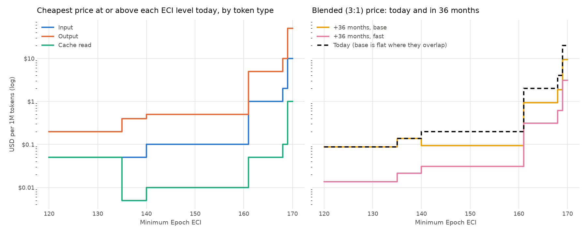

# Token price curve v4: prices per token type, plus a capability lookup

Built by `uv run python scripts/build_curve_v4.py`, after `build_curve.py` (v3). v4 reads v3's files and
never writes them. v3's tiers, base levels and base-case rates are unchanged; v4 only adds detail. All
numbers are in [`curve_v4_results.json`](curve_v4_results.json).

**What v4 adds.**
1. **Separate prices for input, output, cache-read and cache-write tokens**, per tier and scenario, for
   months 0–36. v3 stored only a blended price (3:1 input:output).
2. **A capability lookup:** for every whole ECI threshold from 120 to 169, the cheapest model at or above
   it, each month since 2023-10, and projected 36 months forward under each scenario.

**Check.** v4 rebuilds v3's tier history exactly (largest difference 0), and its blended base prices
match v3's base levels exactly for every tier.

## Prices today (2026-11), USD per 1M tokens

| Tier | Input | Output | Cache read | Cache write | Blended (= v3) | Base case (from v3) |
|---|---|---|---|---|---|---|
| ECI ≥ 120, ≥ 130 | 0.05 | 0.20 | 0.05 (none listed) | 0.05 (none listed) | 0.0875 | flat |
| ECI ≥ 140, ≥ 150, ≥ 160 | 0.10 | 0.50 | 0.01 | 0.125 | 0.20 | ÷1.29 per year |
| mid | 2.00 | 10.00 | 0.25 | 2.00 | 4.00 | flat |
| frontier | 4.50 | 22.50 | 0.225 | 5.625 | 9.00 | flat |

Output costs 4–5× input in every tier today. That ratio has been stable: the median over each tier's
history is 4–6×.

## Method

- **Input and output.**
  - Bands (ECI ≥ N): the current cheapest model's own input and output prices, each the median of its
    last 3 months. This is v3's base-level rule applied to each price separately.
  - Mid and frontier: the median of the tier's monthly median input and output prices over the last 3
    months. A median per type need not come from the same model as the blended median. Today the
    blended price still matches v3 exactly.
- **Cache read and cache write.**
  - Source: the cache-read ÷ input and cache-write ÷ input ratios listed by the source the model's input
    price comes from. That
    is the maker's own LiteLLM rows, v3's reference provider, the median of hosting providers, or
    OpenRouter.
  - No listed price: where that source lists no price, those tokens are priced as ordinary input,
    and `cache_read_listed` / `cache_write_listed = false`. A cache write can cost more than input:
    Anthropic and OpenAI list 1.25× input for Claude Haiku 5.5 and the GPT-6 models.
  - Data: cache-write prices come from LiteLLM's `cache_creation_input_token_cost` (3,284 model-months,
    all from LiteLLM) and OpenRouter's `input_cache_write`. Adding them changed no other value in
    `price_history.parquet` or `prices.parquet`.
  - Effect: gpt-oss-20b (ECI ≥ 120 and ≥ 130) has no discount, because its reference provider,
    together_ai, lists no cache price, while Fireworks and Groq list about 50%. In the mid and
    frontier tiers, 86% and 100% of the models list a cache-read price; 40% and 88% list a cache-write
    price.
  - Mid and frontier are medians across models, so their cache prices need not belong to the model that
    sets the input price. See [the frontier cache-read price](#where-the-frontier-cache-read-price-comes-from).
- **Forward curve.** Each token type moves at its tier's v3 annual factor in each scenario
  (`base`, `fast`, `slow`). v3 fits rates on blended prices only. The stable output:input ratio
  suggests input and output prices move together.
- **Capability lookup** (`capability_v4.csv`).
  - History: for each threshold and month, the cheapest model with ECI at or above it (lowest blended
    price), whatever the number of qualifying models. `n_models` gives the count. Months before
    2026-11 have `scenario = history`.
  - Forward: today's cheapest model at or above the threshold, starting from the median of its last
    3 months. Its rate comes from the v3 band priced by the same model (v3's "same model" rule).
    Otherwise it comes from the nearest v3 band below the threshold.

### Capability lookup today

| Minimum ECI | Cheapest model | Input | Output | Cache read | Cache write | Rate taken from |
|---|---|---|---|---|---|---|
| 120–134 | gpt-oss-20b | 0.05 | 0.20 | 0.05 | 0.05 | ECI ≥ 130 band (same model): flat |
| 135–139 | gpt-5-nano | 0.05 | 0.40 | 0.005 | 0.05 | ECI ≥ 130 band (nearest below): flat |
| 140–160 | Claude Haiku 5.5 | 0.10 | 0.50 | 0.01 | 0.125 | ECI ≥ 160 band (same model): ÷1.29 per year |
| 161–167 | GPT-6.1 Terra | 1.00 | 5.00 | 0.05 | 1.25 | ECI ≥ 160 band (nearest below): ÷1.29 per year |
| 168 | GPT-6.1 Sol | 2.00 | 10.00 | 0.10 | 2.50 | ECI ≥ 160 band: ÷1.29 per year |
| 169 | GPT-6 Astra | 10.00 | 50.00 | 1.00 | 12.50 | ECI ≥ 160 band: ÷1.29 per year |

The workflow layer's capability bands (`config/capability_bands.yaml`) read this lookup at each band's
minimum ECI: floor 120, small 140, mid 154 and frontier 164.

### Where the frontier cache-read price comes from

The frontier figure of $0.225 is not one model's price.
- **How it's built.** Like v3's base level, it is the median of three monthly figures, Sep, Oct and
  Nov 2026. Each monthly figure is the median cache-read price of the models in the frontier tier that
  month.

  | Month | Frontier models | Median cache read |
  |---|---|---|
  | 2026-09 | 8 | $0.50 |
  | 2026-10 | 6 | $0.225 |
  | 2026-11 | 8 | $0.15 |

  The median of the three is October's $0.225.
- **October.** Six models were in the tier: GPT-6.1 Sol $0.10, Claude Opus 5.5 $0.20, Claude Sonnet
  5.5 $0.20, Claude Fable 5.1 $0.25, Claude Opus 5 $0.50 and GPT-6 Astra $1.00. With an even count,
  the median is the average of the middle two: $0.20 (Opus 5.5 and Sonnet 5.5 tie) and Fable 5.1's
  $0.25.
- **Source.** All six prices are the makers' own list prices, from LiteLLM's first-party rows:
  provider `anthropic` for the Claude models and `openai` for the GPT models. No hosting provider is
  involved.
- **Lag.** The 3-month median lags. Nov 2026 alone gives $0.15, and the cheapest frontier cache read
  today is $0.05 (GPT-6.1 Terra).

## Judgement calls

1. **One rate for all token types.** v3's rates were fitted to blended prices. Separate fits per type
   would double the number of noisy series, and the output:input ratio has barely moved.
2. **No cache price listed means no discount.** This overstates cache-read cost where a provider
   offers caching but LiteLLM doesn't list it. It is the conservative choice for a cost model.
3. **Thresholds above 160 use the ECI ≥ 160 rate.** The models there are frontier-priced
   ($2–20 blended). v2 found that a newly reached capability level falls in steps, 1–9 months after it
   first appears, and that the timing can't be forecast. v4 doesn't model a step. A smooth ÷1.29 per
   year is a middle path between the frontier tier (flat) and a step to $0.20.
4. **No cache-write price listed means the input price.** That is right for providers that charge
   nothing extra for writes. It understates cost where a provider charges about 1.25× input but
   LiteLLM doesn't list it.

## Limitations

- **Thin data at the top.** 14 priced models qualify at ECI ≥ 161, but only 3 at ≥ 168 and 1 at ≥ 169.
  The price jumps tenfold from ≥ 160 ($0.20, Claude Haiku 5.5) to ≥ 161 ($2.00). A profile that sets
  `min_eci` near 160 is sensitive to the exact ECI scores.
- **v3's limitations still apply.** These are price only, no usage weighting, and ECI coverage. See
  [curve_v3.md](curve_v3.md).

## Files

| File | Content |
|---|---|
| [`data/curves/curve_v4.csv`](../data/curves/curve_v4.csv), [`.json`](../data/curves/curve_v4.json) | Per tier, scenario and month (months_ahead 0–36): `input`, `output`, `cache_read`, `cache_write`, `blended`, `annual_factor`. The JSON adds each tier's base per type and v3's reason. |
| [`data/curves/tier_history_v4.csv`](../data/curves/tier_history_v4.csv) | v3's monthly tier history with input, output and cache-read prices. |
| [`data/curves/capability_v4.csv`](../data/curves/capability_v4.csv) | Capability lookup: `month`, `eci_min`, `scenario` (`history` for past months), `model`, `model_eci`, prices per type, `rate_from`. |
| [`curve_v4_capability.png`](curve_v4_capability.png) | The chart above. |
